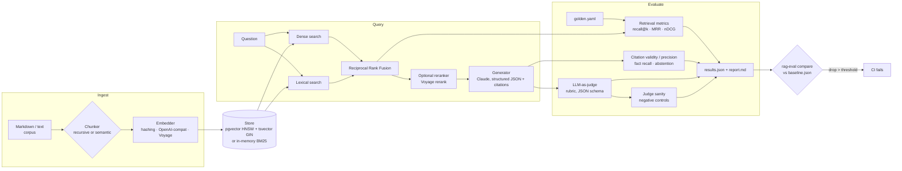

# rag-eval-harness

[](https://github.com/RatulSikder97/rag-eval-harness/actions/workflows/ci.yml)


**Retrieval quality as a CI-gated regression test.**

Most RAG systems are tuned by eyeballing a few answers. Then someone changes the chunk size,
swaps the embedding model or edits the prompt, and recall quietly drops. This repo is a small
but complete RAG pipeline (ingest -> hybrid retrieval -> cited generation with Claude) wrapped
in an evaluation harness. Retrieval and answer quality are scored against a golden set, written
to JSON, and diffed against a committed baseline. A drop larger than the threshold fails the
build, just like a failing unit test.

```text
$ rag-eval compare evals/baseline.json results/current.json --fail-on-regression 0.02
| `retrieval.recall@1` | 0.806 | 0.667 | -0.139 | **REGRESSED** |
...
regression gate failed: retrieval.mrr, retrieval.ndcg@5, retrieval.recall@1, ...   (exit 1)
```

The whole suite, eval gate included, runs **offline with zero API keys**. A deterministic
hashing embedder, an extractive generator and an overlap judge stand in for the real models,
so CI stays fast, free and reproducible. Change one env var and the same code paths run
Claude, OpenAI-compatible or Voyage embeddings, and Postgres + pgvector.

## Architecture



## Quickstart

Requires [uv](https://docs.astral.sh/uv/). Docker is only needed for pgvector.

```bash
git clone https://github.com/RatulSikder97/rag-eval-harness.git
cd rag-eval-harness
uv sync

# Index the bundled corpus (a fictional engineering handbook) and ask a question
uv run rag-eval ingest
uv run rag-eval query "How long does it take to fully erase a closed account's data?"

# Run the golden set: writes results/current.json and results/report.md
uv run rag-eval run

# The CI gate: exit code 1 if any metric drops by more than 0.02
uv run rag-eval compare evals/baseline.json results/current.json --fail-on-regression 0.02
```

Real output of the `query` above (offline defaults):

```text
 1. [data-retention.md#1] 0.0328  ## Customer data deletion When a customer closes their account, their personal data is deleted from primary da
 2. [api-rate-limits.md#2] 0.0320  ## Raising limits Enterprise customers can request a higher limit through their account manager. Temporary inc
 3. [on-call.md#0] 0.0315  ## Rotation The primary on-call rotation is one week long and hands over every Monday at 10:00 UTC. Each rotat
 4. [backups.md#0] 0.0315  ## Backup schedule Primary Postgres databases take a full snapshot every 24 hours and stream write-ahead logs
 5. [feature-flags.md#2] 0.0310  ## Rollout percentages Percentage rollouts are sticky per account: an account that sees a feature at 10% keeps

When a customer closes their account, their personal data is deleted from primary databases within 30 days. Backups containing that data age out within a further 35 days, so complete erasure takes at most 65 days.
citations: data-retention.md#1  ·  fake:extractive
```

### With Postgres + pgvector

```bash
docker compose up -d --wait              # pgvector/pgvector:pg17 on localhost:5433
uv run rag-eval ingest --store pgvector
uv run rag-eval query --store pgvector "What happens if a restore drill misses the RTO?"
uv run rag-eval run --store pgvector     # re-ingests into the table, then evaluates
uv run pytest -m integration             # integration tests against the live database
```

### With Claude and real embeddings

```bash
cp .env.example .env    # then set ANTHROPIC_API_KEY, and RAG_VOYAGE_API_KEY or RAG_OPENAI_API_KEY
RAG_EMBEDDING_DIM=1024 uv run rag-eval run --llm anthropic --embedder voyage
```

Settings come from `RAG_*` environment variables or `.env` (see [`.env.example`](.env.example)).
The CLI flags override them. Generation and judging default to `claude-sonnet-5-5`. Set
`RAG_GENERATION_MODEL` / `RAG_JUDGE_MODEL` to choose another model. Note that a run with
`--llm anthropic` makes about 2 Claude calls per golden item plus 20 for the judge sanity check.

## Sample report

This is real output from `uv run rag-eval run` on the bundled corpus, using the offline
defaults (hashing embedder, extractive generator, overlap judge). The committed
[`evals/baseline.json`](evals/baseline.json) is this run.

| metric | value |
|---|---:|
| `generation.abstention_accuracy` | 0.900 |
| `generation.citation_precision` | 0.750 |
| `generation.citation_validity` | 1.000 |
| `generation.cited_when_answering` | 1.000 |
| `generation.fact_recall` | 0.889 |
| `judge.completeness` | 0.889 |
| `judge.correctness` | 0.750 |
| `judge.groundedness` | 1.000 |
| `judge.pass_rate` | 0.611 |
| `judge.sanity` | 1.000 |
| `retrieval.mrr` | 0.917 |
| `retrieval.ndcg@5` | 0.935 |
| `retrieval.recall@1` | 0.806 |
| `retrieval.recall@3` | 0.972 |
| `retrieval.recall@5` | 1.000 |

The report also has latency percentiles, a per-item table and a "failures to look at" list:

```text
- `restore-drill-miss` — What happens if a quarterly restore drill misses the recovery time objective?
  judge: token f1=0.12, grounded=1.00
```

### Comparing configurations

The same harness compares configurations side by side. These are real numbers on the bundled
corpus with the offline stack:

| config | recall@1 | recall@5 | MRR | nDCG@5 | fact recall | judge pass |
|---|---:|---:|---:|---:|---:|---:|
| `--mode hybrid` (default) | 0.806 | 1.000 | 0.917 | 0.935 | 0.889 | 0.611 |
| `--mode vector` | 0.806 | 0.972 | 0.917 | 0.929 | 0.889 | 0.667 |
| `--mode keyword` | 0.917 | 1.000 | 0.972 | 0.977 | 0.889 | 0.611 |
| `--chunker semantic --chunk-size 300 --chunk-overlap 0` | 0.694 | 0.917 | 0.819 | 0.842 | 0.889 | 0.611 |
| `--chunk-size 150 --chunk-overlap 20` | 0.667 | 0.917 | 0.782 | 0.817 | 0.806 | 0.611 |

How to read this: the hashing embedder is purely lexical, so on a small, keyword-heavy corpus
BM25 alone wins. That is a property of the stand-in embedder, not a general result. With a real
semantic embedder, hybrid retrieval covers both paraphrases (dense) and exact identifiers
(lexical). The harness doesn't argue the point, it measures it on your corpus. The last row is
the regression demo from the top of this README: shrinking chunks to 150 characters splits
answers away from their context, and the gate catches it on 9 metrics.

## What gets measured

| metric | what it catches |
|---|---|
| `retrieval.recall@k` | Share of gold evidence found in the top *k*. Each relevance spec is credited at most once, so a document split into many chunks can't inflate the score. |
| `retrieval.mrr` | How high the first relevant chunk ranks. |
| `retrieval.ndcg@k` | Graded ranking quality (specs can carry `grade: 1-3`). |
| `generation.citation_validity` | Share of cited chunk ids that were actually in the prompt. Catches fabricated citations. |
| `generation.citation_precision` | Share of citations that point at gold-relevant chunks. |
| `generation.cited_when_answering` | A non-abstaining answer must cite something. |
| `generation.fact_recall` | `must_include` facts present in the answer (deterministic, no LLM). |
| `generation.abstention_accuracy` | Answers answerable questions and declines unanswerable ones. |
| `judge.correctness / groundedness / completeness` | LLM-as-judge on a 1-5 rubric, normalised to 0-1, returned as schema-constrained JSON. |
| `judge.pass_rate` | `correctness >= 4 and groundedness >= 4`, recomputed in code rather than trusted from the model. |
| `judge.sanity` | How often the judge scores the true reference above a negative control (another item's reference). If this drops, the judge scores mean nothing. |

Golden items label relevance as **document + evidence string**, not chunk id:

```yaml
- id: erasure-window
  question: How long does it take to fully erase a closed account's personal data, including backups?
  relevant:
    - { doc: data-retention.md, contains: "at most 65 days", grade: 2 }
    - { doc: backups.md, contains: "last 35 days", grade: 1 }
  reference_answer: At most 65 days - 30 days to delete from primary databases plus up to 35 days for backups.
  must_include: [65 days]
```

## Design decisions and trade-offs

- **Chunk-invariant labels.** If golden labels used chunk ids, they would break the moment you
  changed the chunker, and the chunker is one of the main things you want to evaluate. Labelling
  by `doc` + `contains` keeps one golden set valid across chunking strategies. The cost is that
  evidence strings must be exact substrings of the source.
- **RRF over score blending.** Cosine similarity and BM25 / `ts_rank_cd` live on different
  scales. Reciprocal Rank Fusion only uses ranks, so it needs no per-corpus calibration. Fusion
  happens in Python, which keeps the store a thin adapter and lets the in-memory and pgvector
  backends share one retriever.
- **pgvector schema.** HNSW (`vector_cosine_ops`, `m=16`, `ef_construction=64`) for dense
  search. A *generated* `tsvector` column with a GIN index for lexical search, so the index can
  never drift from the text. `hnsw.ef_search` is raised per query to at least *k*, because HNSW
  otherwise returns fewer rows than asked. Natural-language queries are OR-ed rather than run
  through `websearch_to_tsquery`, which ANDs every term and is far too strict for questions.
  The store refuses to open a table whose `vector(n)` doesn't match the embedder.
- **Deterministic fakes are real baselines, not stubs.** The extractive generator picks
  query-overlapping sentences from the retrieved chunks and cites them. If retrieval degrades,
  its answers degrade too, so generation metrics still move in CI. Vector scores are rounded
  before ranking so that BLAS float noise on different CPUs can't flip near-ties and make the
  baseline flaky.
- **Structured outputs over parsing.** Claude is called through the official `anthropic` SDK
  with `output_config.format` (JSON schema) for both answers and judge verdicts. Retries for
  408/409/429/5xx are delegated to the SDK. Refusals (`stop_reason == "refusal"`), truncation
  and malformed JSON raise `LLMError`. The runner records an error on that item instead of
  scoring it 0, and the CI gate counts a missing metric as a regression. Server-side refusal
  fallback (`fallbacks: "default"`) is enabled by default.
- **Prompt-injection hygiene.** Retrieved text is HTML-escaped inside `<document id=...>` tags,
  and both system prompts say documents are data, not instructions. The judge's `passed` flag is
  recomputed from its scores, so a manipulated rationale can't flip the outcome.
- **Trust the judge only as far as you test it.** `judge.sanity` runs negative controls on every
  run, and the judge defaults to `effort: low` to keep its cost proportional.
- **Threshold sizing.** With *n* answerable items, one flipped item moves recall by `1/n`. The
  bundled set has 18 answerable items, so `0.02` means "any single-item regression fails". On a
  larger golden set, raise the threshold or gate only on `--only retrieval.`.

## Project layout

```text
src/rag_eval/
  ingest/       loader (md/txt, front matter), recursive + semantic chunkers
  embeddings/   Embedder protocol, hashing (offline), OpenAI-compatible, Voyage
  store/        VectorStore protocol, in-memory (cosine + BM25), pgvector (HNSW + tsvector)
  retrieval/    hybrid retriever with RRF, reranker hook (+ Voyage reranker)
  generation/   Claude client/generator (structured outputs), extractive fake, prompts
  evals/        golden schema, retrieval + generation metrics, judge, runner, report, compare
  cli.py        rag-eval ingest | query | run | compare
corpus/         bundled fictional handbook (8 docs)
evals/          golden.yaml + committed baseline.json
tests/          offline unit tests + pgvector integration tests (-m integration)
```

## Development

```bash
make check        # ruff + mypy --strict + pytest + eval gate
make integration  # docker compose up + pgvector tests
```

CI runs lint, type checking, the offline test suite, the pgvector integration tests against a
`pgvector/pgvector:pg17` service container, and the eval-regression gate. The gate's comparison
table goes to the job summary and the results are uploaded as an artifact.

To accept an intentional metric change, regenerate the baseline and commit it with the change
that caused it:

```bash
uv run rag-eval run && cp results/current.json evals/baseline.json
```

## License

MIT
